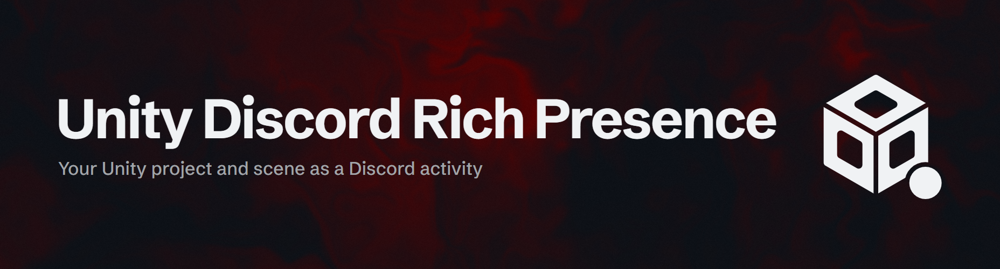

Shows what you are working on in the Unity editor as your Discord activity: the active scene, the project, the time since the editor started, the Unity logo of your editor version and, in VRChat projects, whether it is an avatar or a world project. The package talks to the Discord desktop app over its local IPC pipe and has no native plugin.

## Features

- Activity with the active scene, the project name and the time since the editor started.
- Large image that follows the editor version: the Unity 6 logo on Unity 6, the Unity 2022 logo on Unity 2022.3.
- Small image in VRChat projects, avatar or world, chosen from the installed VRChat SDK.
- Preferences page with the connection status and a preview of the fields sent to Discord.
- Per-project settings: turn the activity off, hide the project or scene name, restart the timer on scene change.
- The activity stays visible while scripts compile and when entering Play Mode.
- Reconnects on its own when Discord starts after Unity or restarts.

## What Discord receives

| Field | Value |
| --- | --- |
| Details | `Scene : <active scene>`, or `Untitled` for an unsaved scene |
| State | `Project : <product name from Player Settings>` |
| Timer | Time since the editor started, or since the last scene change |
| Large image | `unity-6` on Unity 6, `unity` on Unity 2022.3, with the full version on hover |
| Small image | `vrc-avatar` or `vrc-world` when the project has the VRChat Avatars or Worlds SDK, nothing otherwise |

The image names are art assets of the Discord application `956944656032219146`. Discord only shows images uploaded to the application or served over HTTPS, never a local file.

## Requirements

| Dependency | Version |
| --- | --- |
| Unity | 2022.3 or 6000.0 (tested with 2022.3.22f1 and 6000.0.67f1) |
| Operating system | Windows |
| Discord | Desktop app. The browser version has no IPC pipe. |

## Installation

Each [release](https://github.com/ZaphkielTools/UnityDiscordRichPresence/releases) carries three files:

| File | Use |
| --- | --- |
| `dev.zaphkiel.udrpc-<version>.unitypackage` | Open it in Unity. It installs into `Packages/dev.zaphkiel.udrpc`. |
| `dev.zaphkiel.udrpc-<version>.zip` | VPM package, for a VCC listing. |
| `package.json` | VPM manifest of the release, with the zip's `url` and `zipSHA256`, ready to add to a listing. |

### From Git

In the Package Manager, click **+ > Add package from git URL** and enter:

```
https://github.com/ZaphkielTools/UnityDiscordRichPresence.git#v1.0.0
```

Or clone the repository into `Packages`:

```sh
git clone https://github.com/ZaphkielTools/UnityDiscordRichPresence.git Packages/dev.zaphkiel.udrpc
```

## Usage

The activity starts when the editor opens. Open **Edit > Preferences > Discord Rich Presence** to see the connection status and the fields sent to Discord.

| Setting | Effect |
| --- | --- |
| Show on Discord | Turns the activity off for this project. |
| Show project name | Leaves the project name out of the activity. |
| Show scene name | Leaves the scene name out of the activity. |
| Restart timer on scene change | Counts from the last scene change instead of the editor launch. |
| Verbose logging | Logs connections and disconnections to the Console. |

The settings apply to the current project only. They are saved in `UserSettings/DiscordRichPresence.asset`, a folder that Unity's default `.gitignore` leaves out of version control.

## How it works

The package opens the named pipe `\\.\pipe\discord-ipc-0` (up to `-9`) that the Discord desktop app creates, sends a handshake with the application ID, then sends `SET_ACTIVITY` commands. Discord clears the activity when the pipe closes.

- Updates are sent at most once every 4 seconds, and only when a field changes. Text longer than Discord's 128 characters is shortened with an ellipsis.
- When Discord is not running, the package tries again every 5 seconds. When Discord refuses the connection, it waits 60 seconds.
- On a domain reload, the open pipe is handed over to the reloaded scripts, so Discord never sees a disconnection.
- Nothing runs in batch mode or in asset import worker processes.

## Artwork

The images are in `Documentation~/artwork`. Each one is uploaded to the Discord application under the asset name below.

| Asset name | File | Shown |
| --- | --- | --- |
| `unity` | `unity.png` | Large image on Unity 2022.3, the icon of the 2022.3 `Unity.exe` |
| `unity-6` | `unity-6.png` | Large image on Unity 6, the icon of the 6000.0 `Unity.exe` |
| `vrc-avatar` | `vrc-avatar.png`, from `vrc-avatar.svg` | Small image in projects with the VRChat Avatars SDK |
| `vrc-world` | `vrc-world.png`, from `vrc-world.svg` | Small image in projects with the VRChat Worlds SDK |

Both Unity logos come from the editor executable. `extract_unity_icon.py` takes the largest icon frame out of a `Unity.exe` and scales it up to the 512 px minimum of Discord. It needs `pefile` and `Pillow`:

```sh
python extract_unity_icon.py "C:\Program Files\Unity\Hub\Editor\6000.0.67f1\Editor\Unity.exe" unity-6.png
```

## Tests

The EditMode tests live in `Tests/Editor`. Open **Window > General > Test Runner**, select EditMode and run `Zaphkiel.Editor.DiscordRichPresence.Tests`. Unity compiles them for a package cloned into `Packages`. For a package installed from a git URL, add `"testables": ["dev.zaphkiel.udrpc"]` to `Packages/manifest.json`.

`WindowsPipeTransportTests` open a named pipe inside the editor and only run on Windows.

## Project layout

| Folder | Content |
| --- | --- |
| `Editor/Core/` | Settings, session clock, project detection, JSON writer, log |
| `Editor/Ipc/` | IPC frames and messages, Windows pipe transport, Discord client |
| `Editor/Presence/` | Activity builder, send throttling and the editor service |
| `Editor/UI/` | Preferences page and the `DiscordRichPresence.uss` style sheet |
| `Tests/Editor/` | EditMode tests |
| `Documentation~/` | README images and Discord art assets. Unity skips folders whose name ends with `~`. |
| `.github/` | Release workflow, release-please settings and the packaging script |

## Contributing

Commit messages follow [Conventional Commits](https://www.conventionalcommits.org/en/v1.0.0/). Use the folder name as the scope, for example `fix(ipc): retry when the pipe is busy`. [CHANGELOG.md](CHANGELOG.md) lists the changes of each version.

### Releases

[release-please](https://github.com/googleapis/release-please) reads the commit messages on `main` and keeps a release pull request open with the next version and its changelog: `fix` bumps the patch, `feat` the minor, and `!` or a `BREAKING CHANGE:` footer the major. Merging the pull request tags the version, publishes the release and attaches the three files above.

To rebuild the files of an existing release, run the Release workflow from the Actions tab with its tag. To build them on your machine:

```sh
python .github/scripts/package.py --repo ZaphkielTools/UnityDiscordRichPresence --out dist
```

## Trademarks

Unity and the Unity logo are trademarks of Unity Technologies. Discord is a trademark of Discord Inc. This project is not affiliated with either company.
